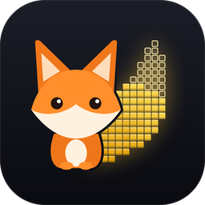

<div align="center">



# Trove-BP

<!-- Project status -->


<!-- Platforms -->


<!-- Tech stack -->


<!-- Project meta -->

[](https://foxhearth.com/discord)
[](https://foxhearth.com/projects/trove-bp)
[](https://aallynreed.github.io/Trove-BP/)

</div>

View and edit Trove's voxel models (`.blueprint`) in the browser. Open a folder of blueprints to turn them around in 3D, or switch to Edit to recolour a model, change its materials, build onto it and download it again. Everything runs on your machine, and nothing gets uploaded.

The decoder and editor reproduce how Trove reads and writes blueprints. The decoder was checked file by file against the reference implementation on all 73,987 blueprints the game ships, and every editing operation on a sample of 924 of them. They started as the blueprint viewer and Blueprint Editor in [KiwiAPI](https://github.com/AallynReed/KiwiAPI), where a server did the decoding; here it all happens in the page.

## Features

- **View.** Open a folder or drop files and every blueprint is listed and searchable. Pick one to see it the way the game shades it, glass and glowing voxels included. Change the backdrop or the sun, and save a PNG.
- **Edit.** Paint colours and materials voxel by voxel or for every voxel that shares a colour or material, add and erase voxels, box-fill, select and move regions, slice through a model to reach its inside, and turn or mirror it. Undo and redo throughout.
- **Layers.** Stack several blueprints, line them up by their attachment points, centres or corners, and union them into one.
- **Check it over.** Tells you where a hat, weapon, mask or decoration breaks Trove's Creations size, orientation and attachment rules, and shows you the voxels in question.
- **Qubicle and MagicaVoxel.** Export a model as the four `.qb` files (model, alpha, specular and type maps) and compile them back into a blueprint.
- **Keeps your work.** Unsaved edits are kept in your browser, so a refresh doesn't lose them.
- **Private.** Files are read from your disk and never leave the machine.

## Quick start

```bash
npm ci
npm run dev
```

Open the printed URL, then choose **Open folder** or **Open files**, drop blueprints on the page, or **Try the demo**. The same works on the [hosted version](https://aallynreed.github.io/Trove-BP/).

Trove keeps its blueprints inside its game archives. Extract them with a Trove modding tool and open the `blueprints` folder.

### Specular finishes

Metal, water, iridescent, waxy and wave finishes are drawn from a texture that ships with the game, `textures/brdfmap.dds`, and this project doesn't redistribute it. Choose **Specular map** and pick that file from your extracted game files (or open a folder that contains it) and the finishes appear. The viewer remembers it in your browser. Without it, every solid shades as rough.

## Controls

| Input | View | Edit |
| --- | --- | --- |
| Drag | Turn the model | Use the current tool |
| Right-drag or Shift-drag | Pan | Pan (camera presets for MagicaVoxel, Blender and Maya under **Controls**) |
| Scroll or pinch | Zoom | Zoom |
| `↑` `↓` | Previous or next model in the list | |
| `1`–`7`, `B` `I` `A` `E` `V` `S` `R` | | Pick a tool |
| `Ctrl+Z`, `Ctrl+Shift+Z` / `Ctrl+Y` | | Undo, redo |
| `[` `]` | | Step through a slice |

## Development

| Script | Purpose |
| --- | --- |
| `npm run dev` | Dev server with hot reload |
| `npm run build` | Production build into `dist/`, deployable to any static host |
| `npm test` | Unit tests (Node's built-in runner) |
| `npm run lint` | ESLint |
| `npm run check` | Lint, test and build, as CI does |
| `npm run corpus -- <reference.jsonl>` | Compare the decoder or editor against a reference dump, file by file |

Node.js 22.13 or newer is required. Pushing to `main` deploys the site to GitHub Pages through `.github/workflows/pages.yml`.

[docs/ARCHITECTURE.md](docs/ARCHITECTURE.md) explains how the pieces fit together and how the corpus check works.

### Browser support

Current Chrome, Edge, Firefox and Safari with WebGL. **Open folder** uses the browser's standard folder dialog, which may word it as an "upload"; files are still only read locally.

## License

[MIT](LICENSE). three.js (r134) and fflate are bundled under their own MIT licenses.

## Trademarks

Trove is a trademark of its owner. This project is not affiliated with or endorsed by them, and it ships none of the game's content. The demo lantern was made for this project.
